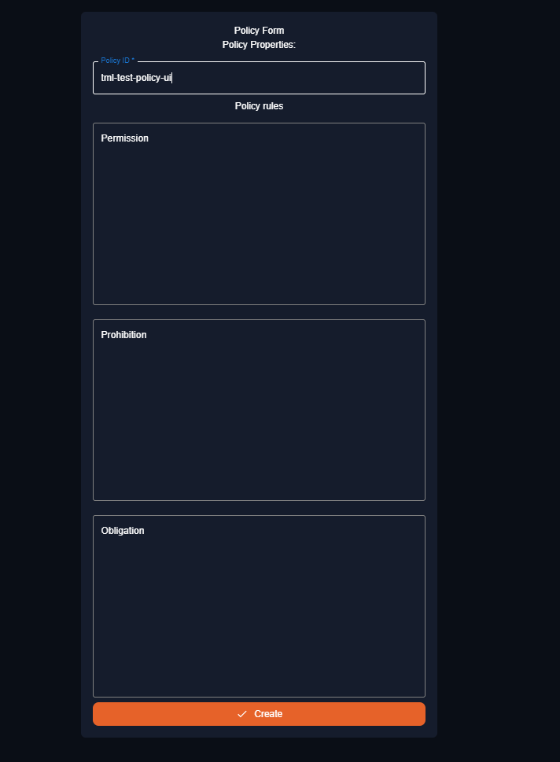
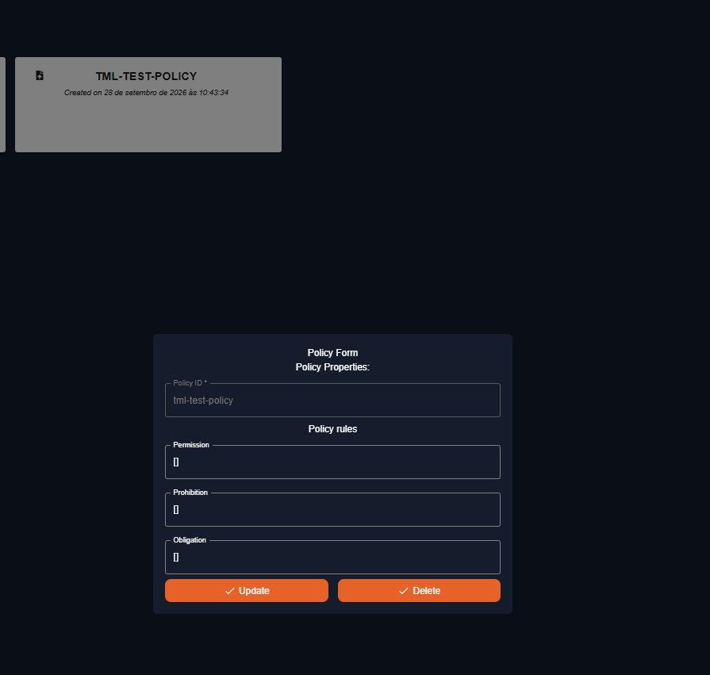
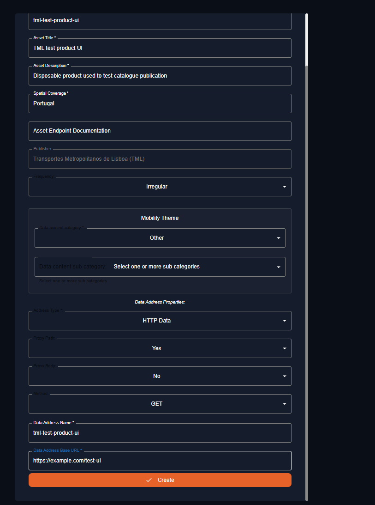
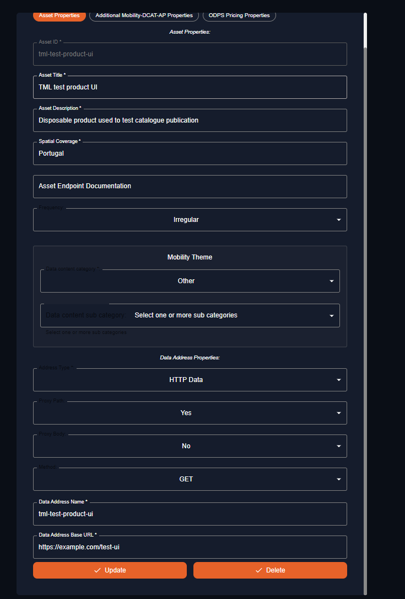
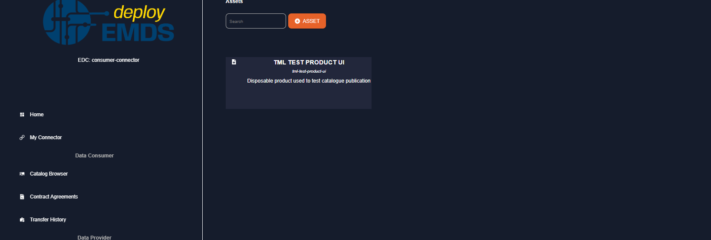
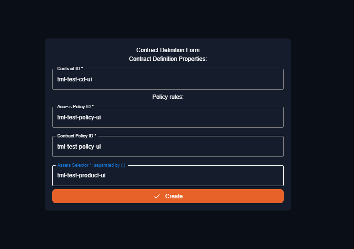
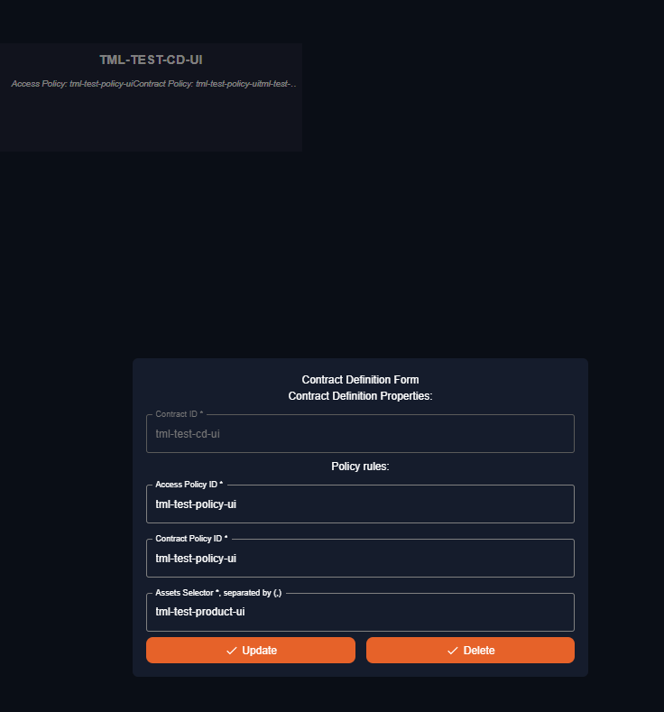
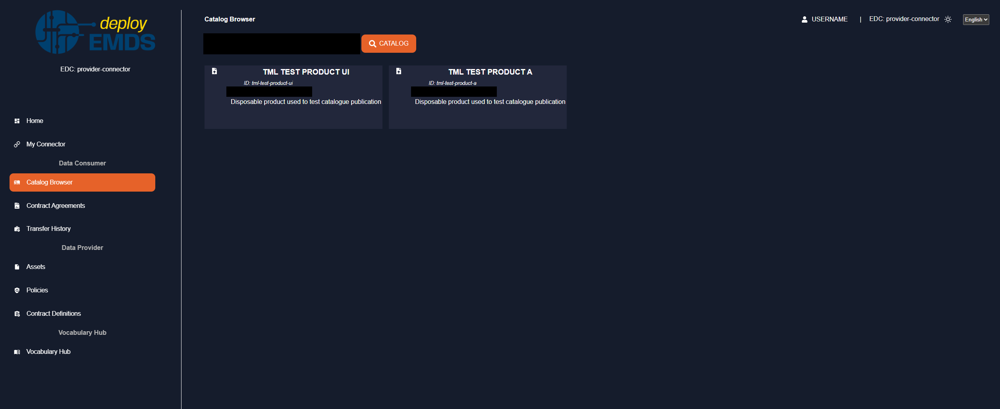

## [2.2.3.1A] Data product publication: Publication - Publication on EMDS catalogue

### Stack: protoEMDS Final Stack (EDC-based)

### Statement of assessment

This file reports the assessment of test `2.2.3.1A` on the **on-premise deployment**, executed by TML Mobilidade. The CaaS assessment is reported in `result_protoemds_final_stack.md`, in the same folder, and is not repeated here.

#### Environment

| Field | Value |
| --- | --- |
| Assessment context | Integration phase assessment of the EMDS final technical infrastructure |
| Result perspective | `protoemds_final_stack`, on-premise deployment |
| Stack under assessment | protoEMDS Final Stack (EDC-based) |
| KPI1 area | Catalogue publication |
| Existing test ID | `2.2.3.1A` |
| Level | UC + Technical |
| ISO/IEC 25010 mapping | Functional suitability, Compatibility |
| Deployment model assessed | On-premise deployment (locally managed) |
| Target environment | Kubernetes cluster (Rancher-managed), TML Mobilidade production infrastructure. Two connectors, each with its own public host and `did:web` identity |
| Executed by | TML Mobilidade |
| Assessment date | 2026-09-28 |
| EDC version / release | `emds-edc-connector` `9916cc5`, based on Eclipse EDC `0.10.0` (controlplane, dataplane, identity hub and STS images), with `emds-edc-connector-ui` `c6e21b8` |
| Connector deployment reference | TML deployment repository (internal GitLab, not publicly reachable), branch `main`, commit `d3074d4`. Steps 0 to 4 ran before the DSP callback change described in the notes; Step 5 repeats the catalogue query on this commit |
| Assessment evidence | Management API requests and responses (curl), dashboard screenshots |

Both connectors belong to TML Mobilidade. Their roles in this test are:

| Role in this test | Connector name shown in the dashboard | Placeholders used below |
| --- | --- | --- |
| Publisher: creates and publishes the product | `consumer-connector` | `<publisher-host>`, `did:web:<publisher-host>` |
| Querying connector: requests the publisher's catalogue | `provider-connector` | `<querying-host>` |

#### Tested quality metric and method

This result reuses the existing stack-agnostic test definition in `test.md` and adds a protoEMDS Final Stack integration-assessment perspective. The quality metric, expected output and comparative criteria remain those defined by the original test.

#### Test-specific assessment scope

Test the process of catalogue publication for a data product under the following conditions: a new data product is published in the catalogue.

### Results

#### Assessment

Pass.

A new asset, policy, and contract definition were created through the publisher connector's Management API. A catalogue request from the querying connector returned `200 OK` and included the product with its expected metadata, DSP endpoint, and `HttpData-PULL` and `HttpData-PUSH` distributions. The same publication flow was also completed through the connector dashboard.

#### Deployment model assessed

| Deployment model | Status | Evidence | Consolidated assessment |
| --- | --- | --- | --- |
| CaaS / IONOS-managed deployment | Not assessed here | See `result_protoemds_final_stack.md` | Reported separately. |
| On-premise deployment | Pass | Management API requests and responses, dashboard screenshots | New test product was visible from the catalogue of a second connector. |

#### Measured results

| Criteria | Measured KPI | Evidence | Notes |
| --- | ---: | --- | --- |
| **No Coverage:** No technical requirements are met. The solution fails to provide any functionality for the new data product in the catalog. | Not selected | API and UI execution | Publication succeeded. |
| **Minimal Coverage:** Up to 25% of the technical requirements are met. Only basic functionalities are implemented, leaving most requirements unaddressed. | Not selected | API and UI execution | Publication succeeded without the limitations described by this level. |
| **Partial Coverage:** Approximately 50% of the technical requirements are met. Key functions are partially implemented, but several critical aspects are lacking. | Not selected | API and UI execution | The complete test path succeeded. |
| **Significant Coverage:** About 80% of the technical requirements are met. Most functionalities work as expected, with only minor gaps needing improvement. | Not selected | API and UI execution | No gap was observed in the scope of this test. |
| **Full Coverage:** All technical requirements are fully met. The solution provides a comprehensive, out-of-the-box solution for the new data product in the catalog. | **4** | API and UI execution | Policy, asset, and contract definition creation returned `200 OK`. The querying connector's catalogue request returned the new product with the expected metadata and distributions. |

**Functional Suitability Quality Metric:** 4

The standard Management API covered the complete publication path without custom changes. The catalogue response confirmed that a second connector could see the new product, so this test meets the Full Coverage criterion on the on-premise deployment.

#### Execution and evidence

The evidence below was collected on 2026-09-28 against the two TML connectors in production. Times are UTC. Hostnames and DIDs are replaced by placeholders and API keys are omitted (`<API_KEY_PUBLISHER>`, `<API_KEY_QUERYING>`). Disposable resource IDs are kept.

Each step shows the API request and response. The same action in the connector dashboard follows when a screenshot exists. The API steps create `tml-test-policy`, `tml-test-product-a` and `tml-test-cd-a`. The dashboard steps create the twin resources `tml-test-policy-ui`, `tml-test-product-ui` and `tml-test-cd-ui`.

##### Step 0: catalogue before publication (09:43:21)

The querying connector requests the publisher's catalogue and counts the entries whose `@id` is `tml-test-product-a`.

Request:

```bash
curl -X POST https://<querying-host>/api/management/v3/catalog/request \
  -H "Content-Type: application/json" -H "x-api-key: <API_KEY_QUERYING>" \
  -d '{
    "@context": {"edc": "https://w3id.org/edc/v0.0.1/ns/"},
    "@type": "CatalogRequest",
    "counterPartyAddress": "https://<publisher-host>/api/dsp",
    "counterPartyId": "did:web:<publisher-host>",
    "protocol": "dataspace-protocol-http"
  }'
```

Response (number of entries with `@id` equal to `tml-test-product-a`):

```
0
```

##### Step 1: create the usage policy (09:43:33)

`POST /v3/policydefinitions` on the publisher connector.

Request:

```bash
curl -X POST https://<publisher-host>/api/management/v3/policydefinitions \
  -H "Content-Type: application/json" -H "x-api-key: <API_KEY_PUBLISHER>" \
  -d '{
    "@context": {"edc": "https://w3id.org/edc/v0.0.1/ns/", "odrl": "http://www.w3.org/ns/odrl/2/"},
    "@id": "tml-test-policy",
    "policy": {
      "@type": "odrl:Set",
      "odrl:permission": [],
      "odrl:prohibition": [],
      "odrl:obligation": []
    }
  }'
```

Response:

```
HTTP 200
```

Dashboard: Policies, `+ POLICY`, with the form filled before clicking `Create` (empty rules, like the API policy):



The policy created through the API also appears in the publisher dashboard, with empty rules and the `Update` and `Delete` buttons:



##### Step 2: create the data product (09:43:33)

`POST /v3/assets` on the publisher connector.

Request:

```bash
curl -X POST https://<publisher-host>/api/management/v3/assets \
  -H "Content-Type: application/json" -H "x-api-key: <API_KEY_PUBLISHER>" \
  -d '{
    "@context": {
      "edc": "https://w3id.org/edc/v0.0.1/ns/",
      "dct": "http://purl.org/dc/terms/",
      "mobilitydcatap": "https://w3id.org/mobilitydcat-ap#"
    },
    "@id": "tml-test-product-a",
    "properties": {
      "dct:title": "TML test product A",
      "dct:description": "Disposable product used to test catalogue publication",
      "mobilitydcatap:mobilityTheme": "https://w3id.org/mobilitydcat-ap/mobility-theme/other"
    },
    "dataAddress": {"type": "HttpData", "baseUrl": "https://example.com/test-a"}
  }'
```

Response:

```
HTTP 200
```

Dashboard: Assets, `+ ASSET`, with the form filled before clicking `Create`:



The created product, opened in the dashboard (`Update` and `Delete` buttons):



The Assets page at that point of the flow lists the product created through the dashboard:



##### Step 3: publish the product with a contract definition (09:43:34)

`POST /v3/contractdefinitions` on the publisher connector, linking the policy to the product.

Request:

```bash
curl -X POST https://<publisher-host>/api/management/v3/contractdefinitions \
  -H "Content-Type: application/json" -H "x-api-key: <API_KEY_PUBLISHER>" \
  -d '{
    "@context": {"edc": "https://w3id.org/edc/v0.0.1/ns/"},
    "@id": "tml-test-cd-a",
    "accessPolicyId": "tml-test-policy",
    "contractPolicyId": "tml-test-policy",
    "assetsSelector": [{
      "operandLeft": "https://w3id.org/edc/v0.0.1/ns/id",
      "operator": "=",
      "operandRight": "tml-test-product-a"
    }]
  }'
```

Response:

```
HTTP 200
```

Dashboard: Contract Definitions, with the form filled before clicking `Create`:



The created definition, opened in the dashboard, with the access policy, the contract policy and the product linked (`Update` and `Delete` buttons):



##### Step 4: catalogue after publication (09:43:43)

The same request as Step 0.

Response (number of entries with `@id` equal to `tml-test-product-a`):

```
1
```

The entry is the product created in Step 2, with title `TML test product A`, an `odrl:Offer` policy and the distributions `HttpData-PULL` and `HttpData-PUSH`. Step 5 shows the entry as returned by the connector.

Dashboard: Catalog Browser of the querying connector. It requests the publisher's catalogue and lists both test products, the one created through the dashboard and the one created through the API. The URL, the DID and the DSP address of each card are hidden.



##### Step 5: catalogue re-check after the DSP callback change (15:57)

The same request as Step 0, repeated on the deployment referenced above.

Response (entry of `tml-test-product-a`, trimmed to the relevant fields):

```json
{
  "@id": "tml-test-product-a",
  "@type": "dcat:Dataset",
  "odrl:hasPolicy": {
    "@type": "odrl:Offer",
    "odrl:permission": [],
    "odrl:prohibition": [],
    "odrl:obligation": []
  },
  "dcat:distribution": [
    {
      "@type": "dcat:Distribution",
      "dct:format": {"@id": "HttpData-PULL"},
      "dcat:accessService": {
        "@type": "dcat:DataService",
        "dcat:endpointUrl": "https://<publisher-host>/api/dsp"
      }
    },
    {
      "@type": "dcat:Distribution",
      "dct:format": {"@id": "HttpData-PUSH"},
      "dcat:accessService": {
        "@type": "dcat:DataService",
        "dcat:endpointUrl": "https://<publisher-host>/api/dsp"
      }
    }
  ],
  "dct:title": "TML test product A",
  "dct:description": "Disposable product used to test catalogue publication",
  "mobilitydcatap:mobilityTheme": "https://w3id.org/mobilitydcat-ap/mobility-theme/other"
}
```

| Evidence | Sanitized observation |
| --- | --- |
| API-01 | Policy, asset, and contract definition creation returned `200 OK`. |
| API-02 | The catalogue of the publisher, requested by the querying connector, went from 0 to 1 entry for the product. |
| API-03 | The entry carries the `odrl:Offer`, both distributions and the public DSP endpoint. |
| UI-01 | The same publication flow was completed through the dashboard, and both products are listed in the Catalog Browser of the querying connector. |
| Scope | One publisher-to-querying-connector path between two TML connectors was assessed. |

#### Notes

This result introduces a **protoEMDS Final Stack** perspective for the existing test `2.2.3.1A` under the KPI1 area **Catalogue publication**. It should not be interpreted as part of the original Phase 1 / Phase 2 stack-comparison campaign.

- Both connectors belong to TML Mobilidade, so no external participant was involved. In EDC the connector that publishes an asset acts as provider for it. The connector names shown in the dashboard (`consumer-connector` and `provider-connector`) come from the deployment and do not follow the role used in this test.
- Steps 0 to 4 and the dashboard steps ran before the DSP callback address of both connectors was changed from the internal LoadBalancer address to the public URL. The change is included in the referenced commit. Until then, the catalogue advertised the internal address as the DSP endpoint. Step 5 repeats the query after the change and shows the public endpoint.
- The `tml-test-*` resources were not removed by this test. `tml-test-product-a` is now referenced by a contract agreement between the two connectors, and EDC does not allow deleting referenced assets or agreements.
- Only the catalogue of one connector, as seen by another TML connector, was assessed. Federated catalogues are out of scope for this test.
