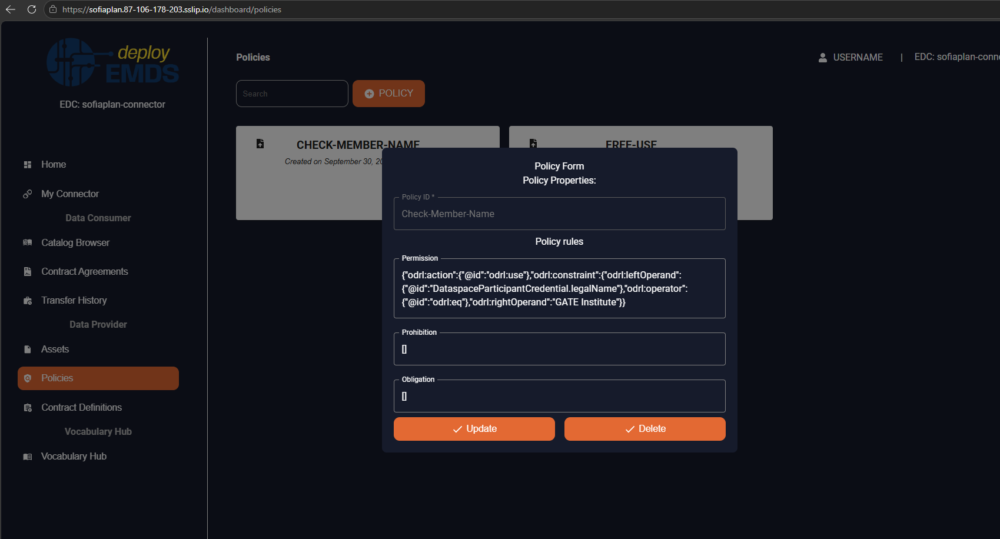
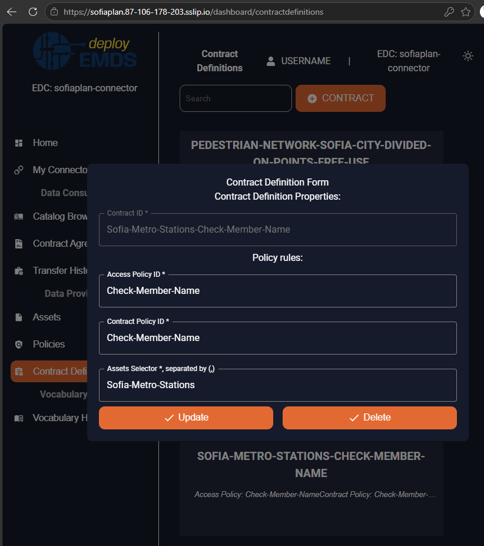
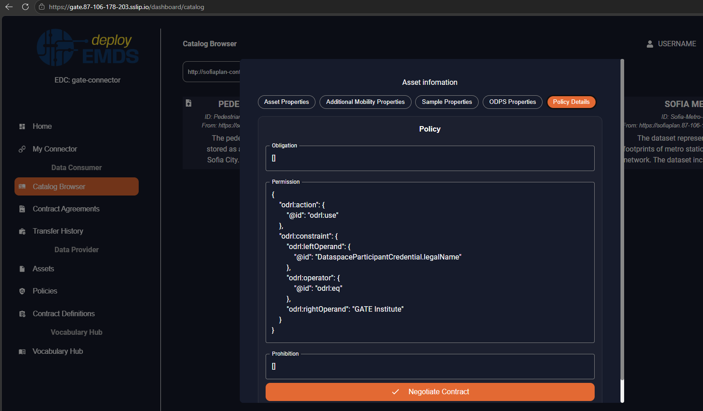
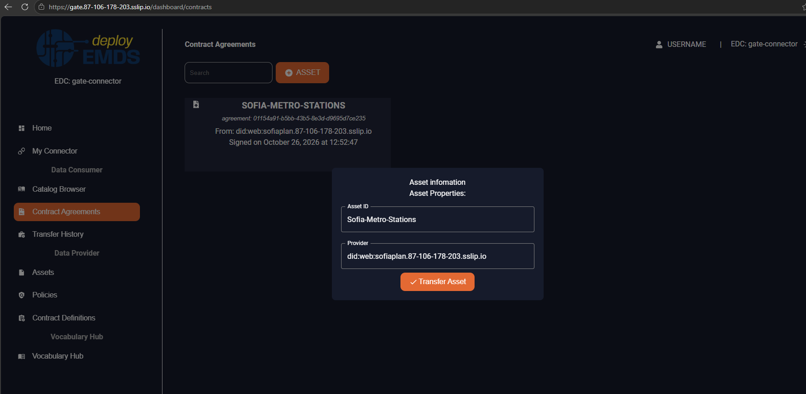
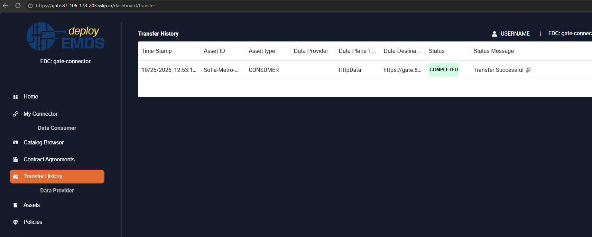
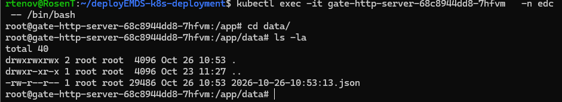

## [5.1.1.1] Data sharing: Data sharing request - Request data transfer

### Stack: protoEMDS Final Stack (EDC-based)

### Statement of assessment

#### Environment

This section identifies the technical context in which the protoEMDS Final Stack assessment is performed.

| Field | Value |
| --- | --- |
| Assessment context | Integration phase assessment of the EMDS final technical infrastructure |
| Result perspective | `protoemds_final_stack` |
| Stack under assessment | protoEMDS Final Stack (EDC-based) |
| KPI1 area | Data sharing request |
| Existing test ID | `5.1.1.1` |
| Level | UC + Technical |
| ISO/IEC 25010 mapping | Functional suitability, Reliability, Security |
| Owner (tentative) | Rosen (GATE) |
| Reviewer | Wilhelm |
| Deployment model assessed | CaaS / IONOS-managed k8s deployment |
| Target environment | CaaS / IONOS-managed k8s deployment |
| EDC version / release | emds-edc-connector 2428e79787ed4fb9cfecc6f10025504e7fb1a676, based on Eclipse EDC 0.10.0, emds-edc-connector-ui 15b794c87e2c5425590f816292f1c629ce8aae09 |
| Connector deployment reference | deployEMDS-k8s-deployment, branch main, commit 94aa638 |
| Assessment evidence | protoEMDS UI screenshots and data-sharing workflow observations |

The assessment should be completed using the deployment model for which evidence is realistically available. It is not mandatory to execute the same test in both CaaS and on-premise environments.

If only one deployment model is assessed, the other one should be marked as `Not assessed`.

#### Tested quality metric and method

This result reuses the existing stack-agnostic test definition in `test.md` and adds an protoEMDS Final Stack integration-assessment perspective.

It does not replace the historical stack-specific result files, such as `result_edc_vc.md` or `result_fiware.md`.

The quality metric, expected output and comparative criteria remain those defined by the original test. This result file should only capture the evidence and assessment outcome for the selected protoEMDS Final Stack deployment.

#### Test-specific assessment scope

Coverage test: assess that the API is available and test that a data sharing request is properly covered: 
- Initiate a data sharing 
- Retrieve data sharing information and status 
- Receive data sharing request outcome condition 
- Retrieve data sharing information of past data sharing actions. 

The system ranks higher if the API is secured and implements common methods, like REST.

#### Expected Output

The test aims to provide a comprehensive evaluation of the following aspects:

- **Assess the Availability of the API:** Ensure that the API is accessible and functional.
- **Test Data Sharing Requests:** Verify that data sharing requests are correctly processed, covering these steps:
    - Initiating a data sharing request.
    - Retrieving information and status of the data sharing request.
    - Receiving the outcome of the data sharing request, including conditions.
    - Accessing information on past data sharing activities.
The system will score higher if the API is secured and utilizes standard methods, such as REST.

### Results

#### Assessment

Successful data transfer observed. A data-sharing workflow was executed through the protoEMDS user interface using the CaaS deployment. The consumer's Transfer History page displays a transfer with status COMPLETED and status message Transfer Successful. The provider's Assets page is available at the SofiaPlan connector UI.

#### Deployment model assessed

| Deployment model | Status | Evidence | Consolidated assessment |
| --- | --- | --- | --- |
| CaaS / IONOS-managed deployment | Executed | Screenshots of Provider Contract Definitions page; Consumer Catalog Browse, Contract Agreements and Transfer History pages | A completed data transfer is visible in the consumer's transfer history. |
| On-premise deployment | TBD | TBD | `Not assessed`. |

#### Measured results

| Requirement | Measured KPI | Notes |
| -|--------------|-------------|
| Initiate a data sharing | 4 | The Provider (did:web:sofiaplan.87-106-178-203.sslip.io) made a Contract Definition for Asset ID Sofia-Metro-Stations (GeoJSON file) with Access Policy ID Check-Member-Name and Contract Policy ID Check-Member-Name.   The Consumer (did:web:gate.87-106-178-203.sslip.io) browse the Provider's catalog by using Catalog Browse page with http://sofiaplan-controlplane:8082/api/dsp and did:web:sofiaplan.87-106-178-203.sslip.io and see the Contract Definition because he met the Access Policy DataspaceParticipantCredential.legalName EQ GATE Institute.  After a successful negotiation of contract by the consumer metting the Contract Policy a contract agreement is shown on Consumer Contract Agreemtents  |
| Retrieve data sharing information and status | 4 | The Consumer's Transfer History page displays the transfer with status `COMPLETED` and message `Transfer Successful`.  |
| Receive data sharing request outcome condition | 3 | The HTTP data-server container of the consumer contains the file. But it is saved as JSON file.  Related to GitHub issue #16 on edc_docker_deployment repo: http-server: preserve the original data format when saving received files https://github.com/deployEMDS/edc_docker_deployment/issues/16 |
| Retrieve data sharing information of past data sharing actions. | 4 | The Consumer's Transfer History page displays a completed transfer record. |

**Overall Calculation:** 3.75
**Functional Suitability Quality Metric Score:** 3.75

#### Notes

This result introduces an **protoEMDS Final Stack** perspective for the existing test `5.1.1.1` under the KPI1 area **Data sharing request**.

This result should not be interpreted as part of the original Phase 1 / Phase 2 stack-comparison campaign. It is intended as an integration phase assessment of the current EMDS final technical infrastructure.

The assessment should be completed using consolidated technical evidence, such as endpoint responses, logs, screenshots, Postman/curl executions, GitHub issues, pull requests, repository references, deployment status or confirmation from the relevant component owner.

This result file was generated from the local `test.md` and, where available, the local `result_edc_vc.md` structure. EDC+VC-specific evidence, values and scores were intentionally not reused.

